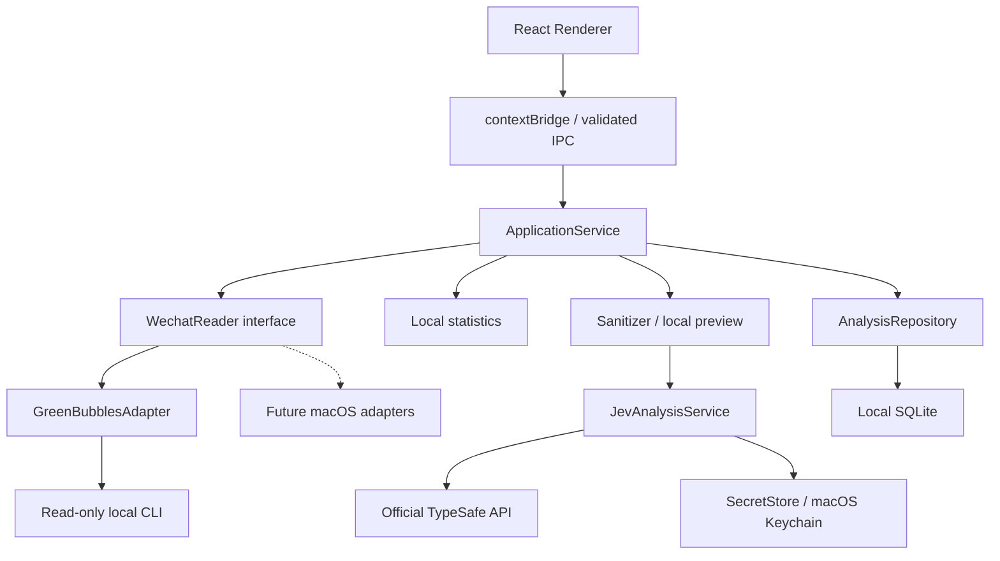

# 研究与架构决策

核查日期：2026-10-08。仅依赖官方仓库和 TypeSafe 官方文档。

## 上游研究

| 项目                                                    | 核查版本                                                | 结构和结论                                                                                                                                                                | 许可证                                                                             |
| ------------------------------------------------------- | ------------------------------------------------------- | ------------------------------------------------------------------------------------------------------------------------------------------------------------------------- | ---------------------------------------------------------------------------------- |
| [WechatVibe](https://github.com/tswawa/WechatVibe)      | b35efa5ec1d1cb4652f56538f9947dac3a57ae75，package 1.3.0 | Electron、SolidJS UI、electron 分析模块、Python bridge/native-reader；Windows 10/11 数据库和窗口相关逻辑不适合直接移植。本工程仅参考功能，没有复制代码或 Windows reader。 | Apache-2.0；若未来复制代码需保留许可证和适用 NOTICE、标注修改。                    |
| [GreenBubbles](https://github.com/bojieli/greenbubbles) | 69f19c7089d7ef011e9ba43d44c6fb4e6e5be98b；发布 v0.10.0  | Rust 查询 CLI、Swift 原生界面、wx-db 解码、SQLCipher/WCDB 读取、独立 acquire helper。优先用 CLI 边界复用成熟读取逻辑。                                                    | MIT；捆绑二进制保留 LICENSE、THIRD_PARTY_NOTICES 和 SBOM，见 vendor/greenbubbles。 |

GreenBubbles [已知限制](https://github.com/bojieli/greenbubbles/blob/main/docs/KNOWN_LIMITATIONS.md)：Apple Silicon、macOS 14+，微信 4.1+；研究 alpha，不承诺所有未来版本兼容。[获取密钥指南](https://github.com/bojieli/greenbubbles/blob/main/docs/PASSPHRASE_ACQUISITION.md)仅声明密钥获取测试覆盖微信 4.1.12/4.1.13。这不是所有消息类型完整兼容的证明。

[数据库格式](https://github.com/bojieli/greenbubbles/blob/main/docs/WECHAT_DATABASE_FORMAT.md)：读取本机 db_storage 下 contact/session/message 多分片和 WAL，不维护完整聊天导出副本。典型加密设置为 4096 字节页、AES-256-CBC、PBKDF2-HMAC-SHA512。通过列签名/别名识别私有格式，遇到覆盖缺口报告不完整。数据库不具有跨分片原子快照。应用拒绝 incomplete 覆盖；附件和非文本只显示占位。

## 真实 CLI 合约

依据 [CLI reference](https://github.com/bojieli/greenbubbles/blob/main/docs/CLI_REFERENCE.md)、src/main.rs、src/live_query.rs 和 tests/live_query_cli.rs：

- `source status`：JSON 状态，`database_count` 是 snake_case；不加不存在的 `--json` 参数。
- `contacts list --details --limit 100 [--cursor …]`：JSON items，有 kind、isAccountHolder、nickname/remark/alias。
- `chats --limit 100 [--cursor …]`：JSON items，id/displayName/sortTimestamp；通过已识别 person 联系人交集过滤群、公众号与未知类型。
- `messages list --conversation <id> --limit 200 --json`：完整 JSON envelope；默认输出是 JSONL，不能直接按 JSON envelope 解析。
- `greenbubbles.query.v1` / formatVersion 1；page.hasMore/nextCursor；consistency.coverageComplete；warnings。
- 普通文字为 `content.Text`；messageType 1；sender 与 accountHolder/contact ID 确认双方方向，无法确认时不分析。

采用 execFile 和参数数组，禁止 shell 拼接；无任意命令 IPC。验证字段、分页、身份和覆盖；数据源 identity 改变时拒绝继续，SQLite metadata 也保持绑定，避免跨重启混合账号。后续应按账号 identity 隔离 SQLite，而不是将多账号混到同一联系人键下。

官方发布 zip 的 SHA-256：`3886b441d85c36a087de34956a14071dbf235166ef4d943df949ea7936c99047`，与核查的 Formula/greenbubbles.rb 一致。复制 query binary 和 acquire helper（用于预检及由用户启动的首次授权）；没有发送 helper，应用没有任何发消息接口。

## 官方 Jev 合约

[官方主页](https://typesafe.ai/)链接到 [API 文档](https://docs.typesafe.ai/api)和[快速开始](https://docs.typesafe.ai/introduction/quickstart)。研究时不采用搜索结果中的社区托管 decide gateway。

唯一分析目的地：`POST https://api.typesafe.ai/v1/systemone`，Bearer Key，model=`jev-latest`，state（string/object/array）和 questions map。不使用 Chat Completions，也不装 OpenAI/Qwen/Ollama SDK。

Score 题：type=`score`、instructions、criteria 有序数组（2–10 级）。本应用用五级行为描述。响应 answers[id] 含 type、score、confidence、legend、probabilities。score 是等级加权位置，五级对应 0–4，UI 换算 `round(score / 4 * 100)`；confidence 是 0–1，缺省时保存 null，不冒充心理状态概率。保存官方返回的实际 model。

请求 30 秒超时，禁止重定向；HTTP/网络失败仅显示安全错误，不打印返回正文。MVP 不自动重试，避免用户未再次发起时重复发送。模型输出严格验证，不使用替代模型或伪造结果。

## 架构

| 模块                           | 责任                                                     |
| ------------------------------ | -------------------------------------------------------- |
| domain/types.ts                | WechatReader、数据模型、仓储和 SecretStore 契约，UI 文案 |
| application/service.ts         | 选中会话、读取和缓存、预览、显式分析、存储结果           |
| infrastructure/greenbubbles.ts | CLI 具体命令、输出 schema、分页、兼容错误、只读          |
| application/sanitizer.ts       | 文本白名单、角色匿名化、已知标识与联系方式/路径清理      |
| application/stats.ts           | 双方数量、会话开启、回复间隔、文本长度、7 天样本频率     |
| infrastructure/jev.ts          | 官方 HTTP 协议、Score 量表、响应验证和映射               |
| infrastructure/sqlite.ts       | sql.js SQLite 文件、本机权限、缓存与分析持久化           |
| native/Keychain.swift          | macOS Security.framework 的凭据操作                      |
| desktop/main.ts + preload.ts   | Node 权限集中在主进程；sandbox、contextIsolation、窄 IPC |
| ui/                            | 联系人、聊天、统计、匿名化预览与指标展示                 |

选择 sql.js 是为了避免 Electron/Node ABI 重编译 SQLite 插件；它仍生成标准 SQLite 文件。目前每次更新导出文件、原子 rename，适合 bounded MVP，后续大规模历史缓存应迁移到 native SQLite（仓储接口保持不变）。

本地统计仅当前样本，近 7 天并非完整历史频率。6 小时静默定义新对话，窗口首条不计；回复为跨发送者相邻消息间隔，排除 6 小时以上间隔。下一阶段可独立拉取 7 天完整分页并报告覆盖。

## 后续优先顺序

1. 由用户完成 GreenBubbles 的真实数据库配置和密钥设置，验证读取一个真实单聊，保留安全诊断码。
2. 用户在客户端保存 TypeSafe Key，主动选取文本进行在线验证（开发代理不自动发送真实聊天）。
3. 增加按账号隔离、可编辑的本地脱敏词典、历史分页、完整 7 天统计、缓存浏览/清除。
4. 加入 arm64 签名/公证、DMG、捆绑 native helper 的打包路径、真实数据兼容回归。

## 后续更新：客户端内部连接插件

增加 `WechatReaderPlugin`、`plugins/greenbubbles-plugin.ts`、受限 connection/openWechatSetup IPC 和应用内连接面板。preflight 只执行上游真实 `preflight --json`，只保留已验证的布尔值与数据库数量，不向 UI 返回账号标识、文件路径、原始错误或任意 remediation 指令。

`ConnectWechat.command` 是本机交互式首次授权助手，不属于自动启动链路。只有用户明确输入 CONNECT 才会执行固定的重签命令和捕获。既有密钥永不覆盖；管理员创建的新文件会归还给当前用户并设为 0600。首次连接需要本人参与管理员授权和微信账号重新登录，之后零导入直接读取。

## 范围与分段扩展（2026-10-08）

ApplicationService 管理读取/分析任务和取消状态。WechatReader 的可选 getMessagePage 使用真实 --since / --until / --cursor 参数，每页 500 条；UI 不调用 CLI。固定范围分页、去重、检查游标及跨库覆盖；保护上限通过继续读取延续。Sanitizer 后由 batches 模块按 UTF-8 字节分段，用户确认计划后按序调用 Jev；本地加权汇总并保留每段 confidence。charts 从全部已读消息本地计算，UI 仅显示最后 300 条正文。SQLite 保存已读消息与完整/部分分析，Keychain 专门保存 TypeSafe Key。
